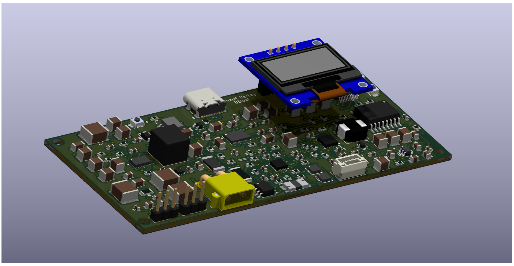
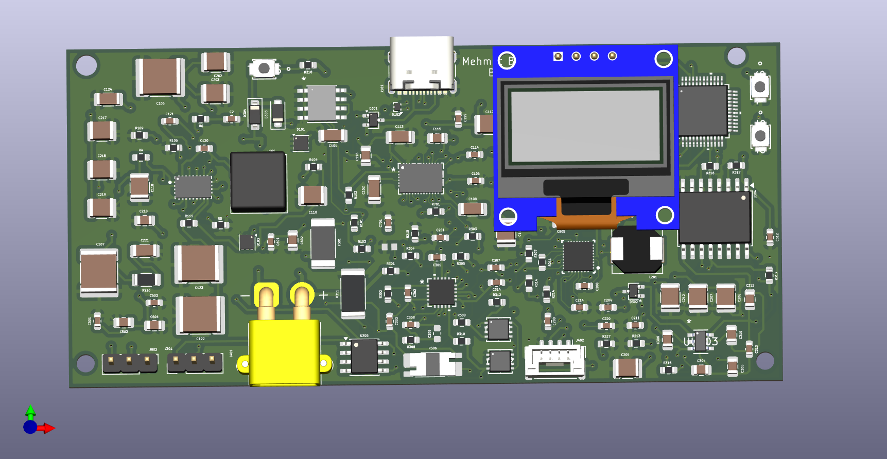
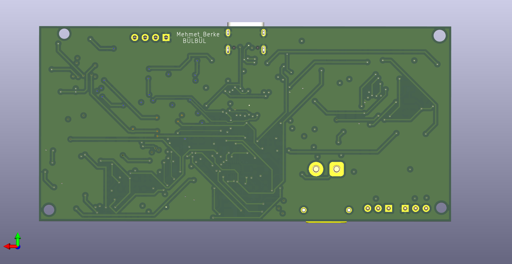

# SmartPowerBank

**A 2S4P lithium-ion power bank with USB-C PD/PPS, battery protection, and embedded control.**

  

<em>KiCad 3D render of the current PCB draft. This is a design preview, not an assembled or tested device.</em>

| Battery | USB-C input target | USB-C output target | PCB |
| :---: | :---: | :---: | :---: |
| 2S4P · ~80 Wh | Up to 60 W PD | Up to 45 W PD/PPS | Four layers |

## Overview

SmartPowerBank explores a compact, single-port power bank architecture. A USB-C power path handles charging and output, while a dedicated battery monitor supervises the two cell groups. An STM32 controller coordinates the user interface and system behavior. The design includes current and temperature sensing, protection FETs, and a small OLED display.

The project documents the complete hardware development process: component selection, hierarchical schematics, PCB layout, design checks, and eventually prototype testing and firmware. Power figures above are **design targets**, not measured performance.

## Current status

**PCB design in progress.** The KiCad schematics, component footprints, initial placement, and a routing draft are available in this repository. The 3D views below show the layout as it stands today. PCB design rule issues, routing details, thermal behavior, protection settings, and electrical performance still require review and validation. **Do not use the current files as manufacturing-ready hardware.**

| Area | Current state |
| --- | --- |
| System architecture and component choices | Defined for this design iteration |
| Hierarchical schematic | Captured in KiCad; ERC checked during development |
| PCB | Four-layer placement and routing draft |
| BOM and primary IC datasheets | Included for review |
| Firmware, bring-up, and measured results | Pending |

## Hardware architecture

| Function | Design choice |
| --- | --- |
| Battery pack | 2S4P Molicel INR-18650-P28A concept; 7.2 V nominal, ~11.2 Ah, ~80.6 Wh |
| USB-C PD interface | TPS25751 family USB-C/PD controller; one bidirectional port |
| Charging and power management | BQ25798 buck-boost battery charger |
| Regulated power conversion | TPS552892 buck-boost converter |
| Battery monitoring and protection | BQ76907, cell-group sensing, current shunt, NTC sensing, protection FETs |
| Control and display | STM32G0-family MCU and compact OLED interface |

The schematic and BOM are the source of truth for exact part numbers, connections, and fitted components. Battery protection thresholds and operating limits must be confirmed before any physical prototype is powered.

## PCB previews

| Top view | Bottom view |
| :---: | :---: |
|  |  |

These are design renders; the copper layout and component placement may change as routing and design-rule review continue.

## Explore the repository

| Path | Contents |
| --- | --- |
| [`hardware/kicad/`](hardware/kicad/) | KiCad project, schematic sheets, PCB, and project libraries |
| [`hardware/bom/`](hardware/bom/) | Component lists and sourcing work |
| [`hardware/datasheets/`](hardware/datasheets/) | Datasheets for the principal ICs |
| [`hardware/mechanical/`](hardware/mechanical/) | Mechanical design work |
| [`assets/images/`](assets/images/) | PCB previews and project images |
| [`docs/`](docs/) | Requirements and engineering notes |
| [`firmware/`](firmware/) | Firmware workspace; implementation pending |
| [`manufacturing/`](manufacturing/) | Reserved for reviewed production outputs |

Open the project with **KiCad 9** from `hardware/kicad/SmartPowerBank/`. Inspect the schematic, PCB, BOM, and design-rule results together; the renders alone do not establish electrical correctness.

## Next milestones

1. Resolve PCB DRC violations and remaining routing issues.
2. Review current paths, switching loops, ground references, creepage/clearances, and thermal copper against component guidance.
3. Reconcile the BOM with exact manufacturer part numbers, footprints, and availability.
4. Finalize the mechanical design and firmware bring-up plan.
5. Build and test a prototype only after the electrical and safety reviews are complete.

---

**Project by Mehmet Berke Bülbül** · Electrical and Electronics Engineering · Bursa Technical University
